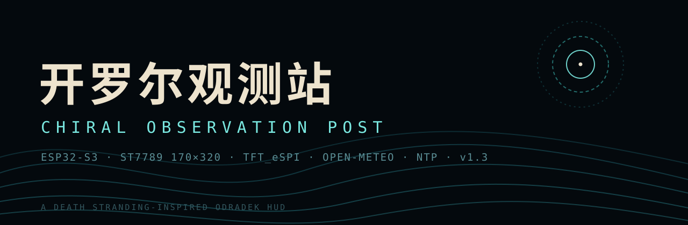

<p align="center">
  
</p>

<h1 align="center">开罗尔观测站 · Chiral Observation Post</h1>

<p align="center">
  
  
  
  
  
  
</p>

<p align="center">一块 1.9 寸屏上的《死亡搁浅》风格终端戒 HUD。屏幕主体是常驻的 1px 等高线地形图，下半屏显示来自真实世界的天气、空气质量、链路时延和 NTP 时钟。</p>

<p align="center">固件为单个 <code>.ino</code> 文件，不依赖服务端、不需要 API Key、不需要注册。</p>

## ✨ 特性速览

- ⛰️ **常驻 1px 等高线地形图** — 双线性插值 + 层号判定，开机画一次永不重绘（2870 像素，占地图 12.2%）
- 🌧️ **TIMEFALL 状态** — 真实降水概率 / WMO 天气码驱动，下雨时整机进入"时间雨"
- 🌫️ **BT 浓度 = PM2.5 / 4** — 数字是真的，"BT" 是死亡搁浅的语义，旁边附真实欧洲 AQI
- 🕐 **NTP 真实时钟** — `ntp.aliyun.com` 校时，UTC+8
- 📡 **CHIRAL 链路条** — 实测 TCP+TLS 握手时延，越短条越长
- 🔌 **配网门户** — captive portal，选 WiFi、填城市即可，凭据只存在板子自己的 NVS 里
- 🚫 **无需 API Key** — Open-Meteo 免费接口，开箱即用

---

## 🎭 1. 什么是真的，什么是合成的

| 内容 | 性质 | 说明 |
|---|---|---|
| 城市名 | 真实 | 用户输入，经 Open-Meteo 地理编码解析 |
| 天气状态 / 气温 / 风速 / 降水概率 | 真实 | Open-Meteo Forecast |
| PM2.5 / AQI | 真实 | Open-Meteo Air Quality（欧洲 AQI） |
| `BT` 数值 | 由真实数据换算 | `PM2.5 / 4`，上限 99；"BT" 是游戏语义 |
| 时钟 | 真实 | NTP，固定 UTC+8 |
| `CHIRAL` 时延 | 真实测量 | 到 `api.open-meteo.com` 的 TCP+TLS 握手耗时 |
| 地形高度场 | 合成 | 正弦 / 高斯叠加，开机计算，不与真实地理对应 |
| 路线（chiral route） | 合成 | 两根正弦采样 + Bresenham 连线 |
| `FREE ROAM` | 固定文字 | 装饰 |

---

## 🔌 2. 硬件

| 项目 | 规格 |
|---|---|
| 开发板 | ESP32-1732S019N |
| SoC | ESP32-S3-N16R8（16 MB Flash / 8 MB OPI PSRAM） |
| 屏幕 | 板载 ST7789，1.9 寸，170×320，无触摸 |
| 串口 | CH340 USB-UART，`/dev/cu.usbserial-*`（macOS），115200 |
| 按键 | 板载 BOOT（GPIO0），低电平按下 |

屏幕全部是板载排线，**不需要自己接线**。TFT_eSPI 的引脚在 `User_Setup.h` 里固定如下：

| 信号 | GPIO | 说明 |
|---|---|---|
| `TFT_MOSI` | 13 | |
| `TFT_SCLK` | 12 | |
| `TFT_CS` | 10 | |
| `TFT_DC` | 11 | |
| `TFT_RST` | 1 | |
| `TFT_BL` | 14 | 背光，`TFT_BACKLIGHT_ON HIGH` |
| `TFT_MISO` | -1 | 未接，只写不读 |
| SPI 端口 | `USE_HSPI_PORT` | |
| SPI 频率 | 40 MHz 写 / 16 MHz 读 | |

---

## 🛠️ 3. 软件环境

| 依赖 | 版本（已验证） |
|---|---|
| Arduino-ESP32 core | 3.3.12 |
| TFT_eSPI | 2.5.43 |
| arduino-cli | 1.5.1 |

TFT_eSPI 的 `User_Setup.h` 必须与板子匹配，内容如下（macOS 路径：`~/Documents/Arduino/libraries/TFT_eSPI/User_Setup.h`）：

```cpp
#define USER_SETUP_INFO "ESP32-1732S019N 170x320"
#define ST7789_DRIVER
#define TFT_WIDTH  170
#define TFT_HEIGHT 320
#define TFT_MISO  -1
#define TFT_MOSI  13
#define TFT_SCLK  12
#define TFT_CS    10
#define TFT_DC    11
#define TFT_RST    1
#define TFT_BL    14
#define TFT_BACKLIGHT_ON HIGH
#define USE_HSPI_PORT
#define SPI_FREQUENCY       40000000
#define SPI_READ_FREQUENCY  16000000
#define LOAD_GLCD
#define LOAD_FONT2
#define SMOOTH_FONT
```

### 一个必须遵守的 include 顺序

`.ino` 里 `FS.h` / `WebServer.h` / `DNSServer.h` / `Preferences.h` **必须排在 `TFT_eSPI.h` 前面**。TFT_eSPI 会先占用 `FS_H` 这个头文件守卫，之后再 include `FS.h` 就是空操作，`WebServer.h` 里的 `FS &fs` 就找不到类型，编译直接报：

```
'FS' was not declared in this scope; did you mean 'fs::FS'?
```

注释里已经写明，调整 include 顺序时别把这条弄反。

---

## ⚡ 4. 编译与烧录

在项目根目录（`DeathStrandingHUD` 的上一级）执行：

```bash
# 编译
arduino-cli compile \
  --fqbn "esp32:esp32:esp32s3:FlashSize=16M,PSRAM=opi,PartitionScheme=app3M_fat9M_16MB,CDCOnBoot=default,UploadSpeed=921600,FlashMode=qio" \
  DeathStrandingHUD

# 烧录（端口按实际修改）
arduino-cli upload -p /dev/cu.usbserial-110 \
  --fqbn "esp32:esp32:esp32s3:FlashSize=16M,PSRAM=opi,PartitionScheme=app3M_fat9M_16MB,CDCOnBoot=default,UploadSpeed=921600,FlashMode=qio" \
  DeathStrandingHUD
```

FQBN 逐项含义：

| 参数 | 值 | 为什么 |
|---|---|---|
| `FlashSize` | `16M` | N16R8 的 16 MB Flash |
| `PSRAM` | `opi` | 8 MB OPI PSRAM |
| `PartitionScheme` | `app3M_fat9M_16MB` | 3 MB 应用区，够用且留余量 |
| `CDCOnBoot` | `default` | 串口走 CH340，不用 USB-CDC |
| `UploadSpeed` | `921600` | CH340 稳定上限 |
| `FlashMode` | `qio` | |

当前固件尺寸：**Flash 1,103,803 B（35%）**，**静态 RAM 80,940 B（24%）**，运行期空闲 heap 约 **221 KB**。

> 烧录时板子会重新枚举串口，`usbserial-10` 和 `usbserial-110` 都可能出现。端口报 `No such file` 就先 `ls /dev/cu.usbserial*` 看一眼。

---

## 📡 5. 首次使用：配网

板子第一次上电时 NVS 里没有 WiFi 账号，会自动进入**配网模式**：屏幕地图中央出现一块提示框：

```
CHIRAL LINK NOT SET
JOIN WIFI
ODRADEK-SETUP
192.168.4.1
```

操作步骤：

1. 手机或电脑连接开放热点 **`ODRADEK-SETUP`**（无密码）
2. 浏览器打开 **`http://192.168.4.1`**（多数手机会自动弹出认证页）
3. **NETWORK** 下拉框选你的 2.4 GHz 网络（列表带信号强度）；如果没扫到，用下面的 **OR TYPE SSID MANUALLY** 手填
4. **PASSWORD** 填 WiFi 密码（开放网络留空）
5. **CITY (english)** 填英文城市名，例如 `Shanghai`、`Chengdu`、`Hangzhou`
6. 点 **LINK**

页面回显 `CHIRAL LINK SAVED` 后，板子约 1.2 秒后自动重启，随后：

- 连接 WiFi（日志 `[WIFI] linked ...`）
- 城市名 → 经纬度解析一次并存入 NVS（`[GEO] ...`）
- NTP 校时（`[NTP] time synced`）
- 拉取天气 + 空气质量（`[NET] ...`）

约 10 秒内屏幕出数。

### 配网相关的兜底逻辑

| 情况 | 行为 |
|---|---|
| 密码错误 / 路由器没开 | 每 15 秒重连一次；**45 秒仍连不上就自动重开门户**，不用长按 BOOT |
| 门户开着的时候 STA 反而连上了 | 自动收掉门户、擦掉提示框、把地图补画回来 |
| 想换城市或换 WiFi | 长按 BOOT 1.5 秒清空配置并重启 |

> 城市名**必须是英文/ASCII**。TFT 内置字库只有 ASCII，含非 ASCII 字符的名字会被整条替换成 `SITE` 显示（经纬度仍然正确）。

---

## 🎛️ 6. 日常使用

### BOOT 键（GPIO0）

| 操作 | 效果 |
|---|---|
| 短按（按住 40 ms 以上再松开） | 立刻重新同步一次外界数据，不等 10 分钟周期 |
| 长按 ≥ 1.5 秒 | 屏幕显示 `CHIRAL LINK RESET`，清空 NVS 命名空间 `odradek`（WiFi + 城市 + 经纬度全部作废）并重启，回到配网模式 |

按键做了 20 ms 防抖；长按触发后不会重复触发。

### 自动节奏

| 行为 | 周期 |
|---|---|
| 天气 + 空气质量同步 | 10 分钟（`NET_PERIOD_MS`） |
| 同步失败后重试 | 20 秒（首次没拿到数据时） |
| WiFi 断线重连 | 15 秒 |
| 断网 45 秒后重开门户 | 一次性 |
| 文本刷新 | 100 ms 只在数值变化时落笔 |
| 渲染循环 | 33 ms 节流，实测 31 FPS |

---

## 🗺️ 7. 屏幕布局

```
┌────────────────────────────────────────┐ y=0
│ DEATH                                  │
│ STRANDING                     [天气图标]│
├────────────────────────────────────────┤ y=44
│ Shanghai                    FREE ROAM  │ y=48
│ CHIRAL                          2.0s   │ y=58
│ ██████████░░░░░░░░░░░░░░░░░░░░░░░░░░░░ │ y=69  链路条
├────────────────────────────────────────┤ y=80
│                                        │
│      1px 等高线地形 + chiral route      │  164×144
│                                        │
├────────────────────────────────────────┤ y=224
│ ODRADEK SCAN                 CLEAR     │ y=233
│ BT 07                       AQI 47     │ y=244
│ RAIN 0%              ▮▮▯▯▯▯▯▯          │ y=255
│ TEMP 18.7C                  WIND 9     │ y=271
│ LINK 2.0s                  SYNC now    │ y=287
│ STRAND TIME              10:48:39      │ y=298
│ ODOradek v1.3                    31    │ y=309
└────────────────────────────────────────┘ y=320
```

### 每个字段

| 位置 | 标签 | 内容 | 来源 | 无数据时 |
|---|---|---|---|---|
| (152,17) | 天气图标 | 晴 / 云 / 云+雨 | `wxState()` | 保留 BB 舱圆环 |
| (6,48) | 城市 | 解析后的地名，字距 2 | 地理编码 | `NO LINK` / `SETUP MODE` |
| (6,58) 右侧 | `CHIRAL` | 握手时延，`<1000` 显示 `784ms`，否则 `2.0s` | `httpsGet` 的 `connMs` | `--` |
| (6,69) | 链路条 | 0–3000 ms 量程，越短越长；<900 ms 青色，否则琥珀色 | 同上 | 空条 |
| (98,233) 右侧 | 状态 | `NO DATA` / `CLEAR` / `OVERCAST` / `TIMEFALL` | `wxState()` | `NO DATA` |
| (6,244) | `BT` | `PM2.5 / 4`，两位补零，上限 99 | PM2.5 | `--` |
| (86,244) 右侧 | `AQI` | 欧洲 AQI 整数 | 空气质量接口 | `--` |
| (6,255) | `RAIN` | 未来一小时降水概率 `%` | `hourly.precipitation_probability` | `--` |
| (126,256) | 降雨条 | 8 格，按约 12.5% 一格点亮；≥76%（第 7 格起）转琥珀 | 同上 | 全灭 |
| (6,271) | `TEMP` | 一位小数 + `C` | `current.temperature_2m` | `--` |
| (86,271) 右侧 | `WIND` | 整数，km/h | `current.wind_speed_10m` | `--` |
| (6,287) | `LINK` | 与 `CHIRAL` 同一个值 | 握手时延 | `--` |
| (96,287) 右侧 | `SYNC` | 距上次成功同步：`now` 或 `12m`；同步失败转琥珀 | `gWx.stamp` | `--` |
| (6,298) 右侧 | `STRAND TIME` | `HH:MM:SS`，字距 2 | NTP | `--:--:--` |
| (164,309) 右侧 | FPS | 每秒统计的帧率 | 固件自身 | — |

### 地图区

- 区域：`(3,80)` 起，`164×144` 像素，外圈有 1px 边框和四角短刻度
- 高度场：82×72 粗场双线性插值到 164×144，**保证等高线能落在单像素上**
- 等高线：与右邻、下邻的等值线层号比较，任一不同即点 1 像素；实测 **2870 个像素（占地图 12.2%）**
- 计曲线：每 3 条线加亮一条，线宽仍是 1px
- 明暗：按高度梯度区分受光坡 / 背光坡，光从左上来
- 水面：高度 < `WATER_V` 的区域画稀疏点划
- 路线：`C_CY_M` 青色，压在等高线之上，每 24 个采样点画一段 5px 竖线当路标
- **这张图开机画一次，之后永不重绘**（配网门户收掉时会补画一次）

---

## 🌧️ 8. 数据来源与判定规则

### 接口（全部免费、无需 Key）

| 用途 | 主机 | 路径 |
|---|---|---|
| 城市 → 经纬度 | `geocoding-api.open-meteo.com` | `/v1/search?name=<城市>&count=1&language=en&format=json` |
| 天气 | `api.open-meteo.com` | `/v1/forecast?latitude=..&longitude=..&current=temperature_2m,weather_code,wind_speed_10m&hourly=precipitation_probability&forecast_hours=1&timezone=auto` |
| 空气质量 | `air-quality-api.open-meteo.com` | `/v1/air-quality?latitude=..&longitude=..&current=pm2_5,european_aqi` |

- 全部走 HTTPS；`WiFiClientSecure` 使用 `setInsecure()`（不校验证书）——只读公共天气数据，省掉 30 KB CA 和校验开销。
- 地理编码**只在首次或改城市后执行一次**，结果写进 NVS，重启不再请求。
- 空气质量接口失败不影响天气：已拿到的字段照常显示，缺的字段保持 `--`。

### TIMEFALL 判定

```cpp
isWet(code): (51..67) || (71..77) || (80..82) || (85..86) || (code >= 95)   // 雨、雪、阵雨、雷暴
rainP >= 60                         -> TIMEFALL
isWet(code) || rainP >= 60          -> TIMEFALL
rainP >= 30 || code >= 2            -> OVERCAST
其他                                 -> CLEAR
```

WMO 天气码 `0` 晴、`1` 基本晴、`2` 多云、`3` 阴、`45/48` 雾、`51..57` 毛毛雨、`61..67` 雨、`71..77` 雪、`80..82` 阵雨、`85/86` 阵雪、`95..99` 雷暴。

### 时钟

```cpp
configTime(8 * 3600, 0, "ntp.aliyun.com", "cn.pool.ntp.org", "pool.ntp.org");
```

时区**固定 UTC+8**，不随地理编码变化。NTP 没对上之前时钟显示 `--:--:--`，但天气照样能取（网络任务不依赖 NTP）。

### 时延

`CHIRAL` 显示的是 **TCP + TLS 握手耗时**，不是整包往返：

1. 先 `cli.connect(host, 443)`，记录耗时 → 这就是链路的真实握手时延
2. 再用 `HTTPClient::begin(cli, ...)` 复用这条已建立的连接发 GET，不会二次握手
3. 串口日志里同时给出 `hs=`（握手）和 `fetch=`（含服务器出数据的总耗时）

国内到 `api.open-meteo.com` 实测 `hs` 约 **1.9–2.0 秒**、`fetch` 约 **4 秒**，属于正常路由，不是固件卡顿。链路条量程因此设为 0–3000 ms。

---

## 📐 9. 参数总表

### 屏幕与布局

| 宏 | 值 | 含义 |
|---|---|---|
| `SCR_W` / `SCR_H` | 170 / 320 | 屏幕尺寸 |
| `MAP_X` / `MAP_Y` | 3 / 80 | 地图左上角 |
| `MAP_W` / `MAP_H` | 164 / 144 | 地图尺寸 |
| `CELL` | 2 | 粗高度场与细场的倍率 |
| `MB_W` / `MB_H` | 82 / 72 | 粗高度场格子数 |
| `FW` / `FH` | 164 / 144 | 细高度场（= 地图像素数） |
| `FN` | 23616 | 细场像素总数 |

### 地形与等高线

| 宏 | 值 | 含义 |
|---|---|---|
| `NBAND` | 6 | 调色带数（低海拔 → 高海拔） |
| `BAND_H` | 43 | 每带覆盖的高度值（≈255/6） |
| `LSTEP` | 26 | 等高线间隔：高度每跨 26 画一条 |
| `MAJOR_EVERY` | 3 | 每 3 条线加亮一条（计曲线） |
| `WATER_V` | 34 | 低于此高度算水面 |
| `MAXROUTE` | 192 | 路线采样点数 |

地形由以下成分叠加，归一化到 0..255：

| 成分 | 系数 | 作用 |
|---|---|---|
| 4 层正弦 | 0.42 / 0.24 / 0.13 / 0.07 | 破碎山脊走向 |
| 中央高斯（带锯齿） | 0.44 | 南北向主山脊 |
| 东北高斯 | 0.55 | 一座高峰 |
| 西南负高斯 | -0.95 | 一个湖盆 |
| 线性倾斜 | 0.16 | 整体坡向 |

路线：`y = FH*0.66 - FH*0.20*sin(6t+0.6) + FH*0.07*sin(15t+2.1)`，采样点之间用 Bresenham 连接。

### 配色

| 宏 | RGB | 用途 |
|---|---|---|
| `C_BLACK` | 0,0,0 | 背景 |
| `C_WHITE` | 255,255,255 | 调色计算用 |
| `C_CREAM` | 237,227,205 | 标题、数值、最高一条色带 |
| `C_CY` | 120,232,224 | 开罗尔青（CLEAR） |
| `C_CY_M` | 60,190,190 | 中等青（路线、图标、链路良好） |
| `C_CY_D` | 18,74,80 | 暗青（标签、分隔线） |
| `C_CY_F` | 9,30,36 | 最暗青（地图外框、脉冲第三圈） |
| `C_AMBER` | 245,166,35 | 琥珀（TIMEFALL、BT、告警） |
| `C_RED` | 196,57,43 | 保留 |
| `C_GREY` | 122,134,142 | 灰（OVERCAST、`FREE ROAM`） |
| `C_SLATE` | 38,52,64 | 石板灰（未点亮的条、FPS、分隔线） |

每条色带的 4 个颜色 `PAL[band][0..3]`：

| 索引 | 内容 |
|---|---|
| `[0]` | 底色 |
| `[1]` | 受光面 = 底色向白插值 42% |
| `[2]` | 背光面 = 底色向黑插值 38%（不能压到纯黑，否则最低几条带会消失） |
| `[3]` | 计曲线 = 底色向白插值 72% |

6 条色带底色：`(16,62,74)` `(22,96,104)` `(34,132,138)` `(74,176,176)` `(150,214,206)` `(237,227,205)`。

### 时间与网络

| 宏 | 值 | 含义 |
|---|---|---|
| `NET_PERIOD_MS` | 600000 | 正常同步周期（10 分钟） |
| `NET_TLS_MS` | 12000 | 连接 / 读取超时（12 秒） |
| `BTN_PIN` | 0 | BOOT 键 |
| 网络任务栈 | 10240 B | TLS 握手需要较大的栈 |
| 网络任务核心 / 优先级 | core 0 / 1 | 渲染跑在 core 1，互不抢 |
| NTP 时区 | 8×3600 s | UTC+8 |
| 文本刷新 | 100 ms | 且值未变化时不落笔 |
| 帧节流 | 33 ms | 约 30 FPS |

### NVS 存储（命名空间 `odradek`）

| 键 | 类型 | 内容 |
|---|---|---|
| `ssid` | String | WiFi 名称 |
| `pass` | String | WiFi 密码 |
| `city` | String | 用户输入的城市（原文） |
| `lat` / `lon` | Float | 解析出的经纬度 |
| `geo` | Bool | 待解析标记（`true` = 需要地理编码） |
| `place` | String | 地理编码返回的显示名（重启直接显示） |

> 本固件不预置任何 WiFi 凭据，配置只存在于板子自己的 NVS 里。

---

## ⚙️ 10. 运行原理

### 开机序列（实测约 4.7 秒）

1. 开罗尔脉冲环：三圈环从中心向外推
2. 两条导轨线对向扫出
3. `BRIDGES` 逐字长出 → 字距拉开 → 压暗淡出
4. `CHIRAL NETWORK` 打字机 + 进度条走到 `LINK ESTABLISHED`
5. `DEATH` / `STRANDING` 逐字敲出 + 中线展开
6. 扫描线自上而下把画面擦干净，交给主界面

之后：`buildTerrain()` → `buildFineField()` → `buildPalette()` → `buildRoute()` → 底图 `drawStaticMap()` 画一次 → 进入主循环。

### 主循环（约 30 FPS）

```
每 33 ms：
  netPoll()        // 门户请求 / 断线重连 / 状态上报
  pollButton()     // 按键消抖与长短按判定
  updateReadouts() // 只重写变化的文字区域和条
  FPS 统计 + 1 秒一次串口状态行
```

### 网络任务

独立任务固定在 core 0，循环：

```
每 500 ms：
  没连上 WiFi → 跳过
  有按键请求，或超过 10 分钟，或（从未成功且距上次尝试 > 20 秒）→ 同步一次
  失败 → 若屏上已有旧数据则标记 stale（SYNC 转琥珀），旧值保留
```

同步顺序：地理编码（条件执行）→ 天气 → 空气质量。数据写入 `gWx` 前后用 `portENTER_CRITICAL` 保护，UI 侧整结构体拷贝后再渲染。

### 视觉上的稳定性怎么来的

- 底图只写一次，之后没有任何全屏重绘
- 文字按区擦除重写，且先和上一帧的字符串比较，相同就一个字节都不发
- 天气图标只在状态变化时重画（整块 29×29 先清空，晴/阴/雨不会互相残留）
- 网络请求不在渲染线程，TLS 握手卡的是网络任务，不是画面

---

## 🖥️ 11. 串口日志

115200，8N1。常用标签：

| 标签 | 示例 | 含义 |
|---|---|---|
| `[BOOT]` | `[BOOT] Death Stranding Odradek Topo Scanner v1.3` | 启动 |
| `[TFT]` | `[TFT] 170 x 320` | 驱动上报的屏幕尺寸 |
| `[MAP]` | `[MAP] 2870 contour px = 12.2% of map` | 等高线像素数 |
| `[CFG]` | `[CFG] portal: join wifi ODRADEK-SETUP, open http://192.168.4.1` | 配网门户 |
| `[CFG]` | `[CFG] saved ssid=XXX city=Shanghai` | 门户保存 |
| `[WIFI]` | `[WIFI] linked XWing_2.4G rssi=-39 ip=192.168.1.174` | 连接成功 |
| `[GEO]` | `[GEO] Shanghai -> 31.2222, 121.4581 (Shanghai)` | 城市解析结果 |
| `[NTP]` | `[NTP] time synced` | 校时成功 |
| `[NET]` | `[NET] 18.7C code=1 rain=0% pm2.5=28 aqi=47 hs=1996ms fetch=4457ms city=Shanghai` | 一次完整同步 |
| `[BTN]` | `[BTN] short press -> sync now` | 按键 |
| `[HUD]` | `[HUD] fps=31 wifi=UP 10:48:39 t=18.7C rain=0% code=1 pm25=28 aqi=47 rtt=1996ms heap=221380` | 每秒状态 |

`[HUD]` 里的 `wifi=` 三种取值：`UP`（已连接）、`DOWN`（有配置但没连上）、`PORTAL`（配网模式）。

macOS 上读串口可以直接用 Python 的 termios 读法，注意脚本要留够缓冲时间，`timeout` 太短会一个字都看不到。

---

## 🩹 12. 故障排查

| 现象 | 原因 / 处理 |
|---|---|
| 屏幕全黑但有串口输出 | 检查 `User_Setup.h` 的 `ST7789_DRIVER`、`TFT_BL 14`、`TFT_BACKLIGHT_ON HIGH` |
| 编译报 `'FS' was not declared` | include 顺序被改动了，`FS.h` 必须在 `TFT_eSPI.h` 之前 |
| 花屏 / 颜色异常 | 确认 `USE_HSPI_PORT` 和 40 MHz；换排线 |
| 一直停在配网模式 | 正常，说明 NVS 里没有凭据；按第 5 节配网 |
| 配网保存后连不上 | 5 GHz 网络 ESP32-S3 连不上，必须选 2.4 GHz；密码打错时 45 秒后会自动重开门户 |
| 城市显示 `SITE` | 输入了非 ASCII 城市名，改用英文 |
| 城市显示 `NO LINK` | 还没成功同步过，或 WiFi 未连接 |
| `RAIN` / `TEMP` 一直是 `--` | 看 `[NET]` 日志：`weather failed` 说明接口请求失败，检查网络能否访问 open-meteo |
| `SYNC` 变琥珀 | 最近一次同步失败，屏上是旧数据；短按 BOOT 立刻重试 |
| `CHIRAL` 显示 `2.0s` 且条子短 | 正常，国内到 open-meteo 的握手就是 2 秒左右 |
| 气温差一天 | 数据是实时当前值，不是预报；`timezone=auto` 只影响降水概率的时次 |
| 烧录报端口不存在 | 板子重新枚举了串口，重新 `ls /dev/cu.usbserial*` |
| 想彻底重置 | 长按 BOOT 1.5 秒，或重烧固件后长按一次清 NVS |

---

## 🚧 13. 已知限制

- **地形和路线是合成的**，不与真实经纬度对应；只有文字数据和链路时延是真的。
- 证书不校验（`setInsecure()`）。用于公共只读数据没问题，不适合传输敏感信息。
- 时区固定 UTC+8，去其他时区需要改 `configTime` 的第一个参数。
- 一次同步最多 3 个 HTTPS 请求（首配时多一个地理编码，共 4 个），每个约 2 秒握手。
- 没有 OTA、没有背光调光、没有休眠；屏幕常亮，空闲功耗就是整块板的功耗。
- 屏上字库只有 ASCII，所有要显示的文字都必须是 ASCII。

### 后续可以做的

- 背光 PWM（GPIO14）按环境亮度或夜间时段调暗
- 空闲时把帧率从 30 降到 5，进一步省电
- 日出/日落倒计时（Open-Meteo 的 `daily.sunrise/sunset`）
- 两块板之间用 ESP-NOW 组"开罗尔网络"，把对方的数据显示成节点
- OTA 更新
